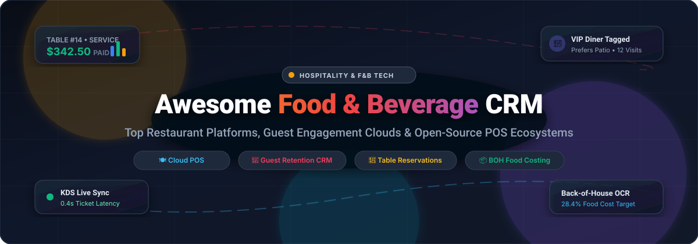

<p align="center">
  <a href="https://github.com/ishandutta2007/Awesome-Awesome-Awesome"></a><a href="https://discord.gg/jc4xtF58Ve"></a>
  <a href="https://github.com/ishandutta2007/Awesome-Food-Beverage-CRM/stargazers"></a>
  <a href="https://github.com/ishandutta2007/Awesome-Food-Beverage-CRM/network/members"></a>
  <a href="https://github.com/ishandutta2007/Awesome-Food-Beverage-CRM/pulls"></a>
  <a href="https://github.com/ishandutta2007/Awesome-Food-Beverage-CRM/blob/main/LICENSE"></a>
  <a href="https://github.com/ishandutta2007"></a>
</p>

<p align="center">
  
</p>

# 🍽️ Awesome Food & Beverage CRM

> A curated directory of premier **SaaS platforms** and **open-source projects** powering modern **Food & Beverage (F&B) CRM**, restaurant point-of-sale (POS), guest loyalty, table reservation management, and back-of-house operational automation.

---

## 📑 Table of Contents
- [🌐 Sector Overview & Market Dynamics](#-sector-overview--market-dynamics)
- [💼 SaaS & Commercial Platforms](#-saas--commercial-platforms)
- [🔓 Open-Source GitHub Projects](#-open-source-github-projects)
- [🧩 Architecture & Common Integrations](#-architecture--common-integrations)
- [🤝 How to Contribute](#-how-to-contribute)
- [📈 Star History](#-star-history)
- [💖 Support & Sponsorship](#-support--sponsorship)
- [⚖️ Disclaimer & Compliance](#️-disclaimer--compliance)

---

## 🌐 Sector Overview & Market Dynamics

The global **Food & Beverage CRM and Restaurant Management Software (RMS)** market is estimated at **$5.8 billion in 2024–2025** and is projected to expand to **$15.2 billion by 2032**, demonstrating a Compound Annual Growth Rate (CAGR) of **14.8%**.

**Market Structure & Fragmentation:**
- **Moderately Fragmented with Strong Platform Consolidation:** The market remains moderately fragmented across specialized operational sub-segments—front-of-house table reservations, cloud point-of-sale (POS), inventory OCR, and manufacturer trade spend management.
- **Ecosystem Aggregation (Not Winner-Take-All):** Rather than a singular winner-take-all monopoly, vertical category giants have emerged through high-value M&A (e.g., DoorDash acquiring SevenRooms for $1.2B, Fiserv acquiring BentoBox for $317M, Shift4 acquiring Revel for $250M, and Lightspeed acquiring Upserve for $430M). Restaurants frequently deploy a best-of-breed hybrid stack (e.g., Toast or Square for POS + SevenRooms or OpenTable for diner acquisition + MarginEdge for back-of-house invoice automation).

---

## 💼 SaaS & Commercial Platforms

The following table summarizes market-leading commercial F&B CRM and restaurant operations systems, sorted in descending order by parent company scale (valuation or market capitalization):

| 🏢 Platform | 💰 Company Scale (Valuation / Revenue) | 🏷️ Starting Price | 🎁 Free Tier / Free Trial Limits | 🎯 Key Strengths & Core F&B Focus |
| :--- | :--- | :--- | :--- | :--- |
| **[Salesforce F&B / CG Cloud](https://www.salesforce.com/)** | **~$290B Market Cap** ($38B Annual Rev; NYSE: CRM) | **$140 / user / month** (Retail Execution tier, billed annually) | **30-day full-access trial** (pre-loaded with F&B demo dataset; direct store delivery routing and task execution) | Enterprise food manufacturer & distributor CRM, trade promotion management, farm-to-fork supply traceability, Einstein AI demand forecasting. |
| **[OpenTable](https://www.opentable.com/)** | **~$165B Parent Market Cap** (Booking Holdings, NASDAQ: BKNG; $2.6B acquisition) | **$149 / month** (Basic Plan, + $1.50 per network cover) | **30-day free trial on Basic Plan** (covers direct online table bookings, takeout widget, and diner profiles; 0-day trial on Core/Pro) | World’s largest consumer diner booking network, automated guest recognition, shift table pacing, VIP diner history auto-profiles. |
| **[BentoBox](https://getbento.com/)** | **~$85B Parent Market Cap** (Fiserv, NYSE: FI; $317M acquisition; ~$15M+ ARR) | **$119 / month** (Website & Restaurant Commerce Foundations) | **14-day interactive demo sandbox** (full access to menu design, online ordering setup, and gift card preview on sales request) | High-conversion restaurant website CMS, commission-free online ordering, branded digital gift cards, event catering management. |
| **[SevenRooms](https://sevenrooms.com/)** | **~$70B Parent Market Cap** (DoorDash, NYSE: DASH; $1.2B cash acquisition; ~$50M+ ARR) | **$300 / venue / month** (Flat-fee SaaS; 0 per-cover booking fees) | **14-day guided trial upon demo qualification** (unlimited guest auto-tagging, floor plan designer, automated email/SMS guest marketing) | Guest-first hospitality CRM, direct multi-channel reservation booking (Google, Instagram, Yelp), AI marketing journeys, lifetime guest spend tracking. |
| **[Square for Restaurants](https://squareup.com/us/en/point-of-sale/restaurants)** | **~$42B Market Cap** ($23B Annual Rev; Block, Inc., NYSE: SQ) | **$0 / month** (Free tier) or **$60 / location / month** (Plus tier) | **Permanent Free Plan ($0/month)**: Unlimited POS devices, conversational menu modifier, live seating layout, pay-as-you-go processing (2.6% + 10¢); **30-day free trial** for Plus plan. | Fast-casual and table-service POS, real-time table layout sync, integrated kitchen display system (KDS), QR order-and-pay. |
| **[Toast POS](https://pos.toasttab.com/)** | **~$18B Market Cap** ($6.2B Annual Rev; NYSE: TOST) | **$0 / month** (Starter Kit software base) or **$69 / month** (Core POS plan) | **Permanent Free Plan ($0/month software)**: Starter Kit supports 1–2 POS terminals, cloud sales reporting, and takeout ordering (pay-as-you-go transaction rates); 0-day trial. | Dominant cloud restaurant management ecosystem, Toast Tables reservations, kitchen display routing, handheld tableside ordering, integrated restaurant payroll. |
| **[Revel Systems](https://revelsystems.com/)** | **~$7B Parent Market Cap** (Shift4 Payments, NYSE: FOUR; $250M acquisition; 18,000+ venues) | **$99 / terminal / month** (billed annually with 3-yr processing agreement) | **60-day (2-month) free trial** on platform subscription modules upon merchant onboarding; no permanent free tier. | Enterprise iPad POS built for multi-location restaurant chains, real-time inventory decrementing, open API architecture, shift employee scheduling. |
| **[Lightspeed Restaurant](https://www.lightspeedhq.com/)** | **~$1.4B Market Cap** ($1.2B Annual Rev; NYSE/TSX: LSPD) | **$69 / month** (billed annually, Starter POS tier) | **14-day free trial** (unlimited access to table management, visual floor builder, itemized menu management; no credit card required). | High-end hospitality POS serving 200+ Michelin-starred restaurants, hotel PMS synchronization, raw-ingredient tracking, multi-region tax compliance. |
| **[Upserve](https://upserve.com/)** | **$430M Acquisition Valuation** (Acquired by Lightspeed Commerce; ~$40M annual rev) | **$99 / month** (Core Plan + $60/month per additional terminal) | **14-day interactive demo sandbox** (guided server scorecard analysis and menu intelligence walkthrough on sales request). | Restaurant analytics engine, server tip and turnover scorecards, menu item margin engineering, integrated daily shift logbooks. |
| **[MarginEdge](https://www.marginedge.com/)** | **~$200M Valuation** ($184M Total Funding, Series D; ~$40M ARR) | **$330 / month / location** (Flat subscription, unlimited invoice scans) | **14-day live sandbox access on demo qualification** (unlimited invoice OCR extraction, live vendor pricing sync, plate costing trial). | Back-of-house automated invoice OCR processing, line-item price alerts, daily controllable P&L tracking, recipe costing, automated vendor bill pay. |
| **[TouchBistro](https://www.touchbistro.com/)** | **~$100M Acquisition Valuation** (Constellation Software / Harris; ~$110M ARR) | **$69 / month** (Solo POS license, billed annually) | **30-day free trial** (complete iPad POS floor plan simulation, menu modifier setup, and guest account workflows). | Hybrid local-network iPad POS (continuous offline mode during internet outages), interactive table floor plan designer, tableside order and bill splitting. |

---

## 🔓 Open-Source GitHub Projects

Explore battle-tested open-source platforms and self-hosted frameworks for restaurant management, point-of-sale, table bookings, customer relationship management, and food supply chain tracking. Repositories are sorted in descending order by GitHub Stars_Count:

1. **[Odoo](https://github.com/odoo/odoo)** [](https://github.com/odoo/odoo/stargazers)  
   *Comprehensive Open-Source Business & POS Suite (LGPL-3.0)*  
   Features specialized restaurant modules including floor plan mapping, split billing, kitchen order tickets (KOT), bar management, real-time inventory reconciliation, and extensible customer loyalty modules.

2. **[ERPNext](https://github.com/frappe/erpnext)** [](https://github.com/frappe/erpnext/stargazers)  
   *Full-Featured Open-Source ERP with Hospitality & POS Capabilities (GPL-3.0)*  
   Offers deep operational coverage for food distributors and restaurant chains: inventory batch management, expiration tracking, multi-currency accounting, supplier purchase orders, and customizable customer CRM.

3. **[Grocy](https://github.com/grocy/grocy)** [](https://github.com/grocy/grocy/stargazers)  
   *Self-Hosted Groceries, Pantry & Inventory Management System (MIT)*  
   Ideal for cafes, micro-breweries, and commercial test kitchens requiring barcode scanning, recipe ingredient tracking, minimum stock level alerts, and batch expiration tracking.

4. **[Open Source POS](https://github.com/opensourcepos/opensourcepos)** [](https://github.com/opensourcepos/opensourcepos/stargazers)  
   *Web-Based Point of Sale System (MIT)*  
   Built with PHP and CodeIgniter. Offers itemized sales checkout, daily receipts, customer database recording, gift cards, expense logging, and inventory quantity management suitable for counter-service cafes and kiosks.

5. **[Easy!Appointments](https://github.com/alextselegidis/easyappointments)** [](https://github.com/alextselegidis/easyappointments/stargazers)  
   *Open-Source Booking & Reservation Scheduler (GPL-3.0)*  
   Easily tailored for restaurant dining reservations, private dining room bookings, wine tastings, and chef's table sessions with Google Calendar two-way synchronization and SMS reminders.

6. **[TastyIgniter](https://github.com/tastyigniter/TastyIgniter)** [](https://github.com/tastyigniter/TastyIgniter/stargazers)  
   *Dedicated Open-Source Restaurant Online Ordering & Table Management System (MIT)*  
   Built specifically for the food and beverage industry. Features interactive table reservations, responsive online menu ordering, delivery zones with fee calculations, kitchen management, customer order history, and multi-location restaurant support.

7. **[EspoCRM](https://github.com/espocrm/espocrm)** [](https://github.com/espocrm/espocrm/stargazers)  
   *Lightweight & Highly Customizable Open-Source CRM (GPL-3.0)*  
   Adaptable for hospitality groups and corporate food caterers to log guest profiles, corporate event inquiries, automated email campaigns, order history, and dietary preferences.

8. **[Akeneo PIM](https://github.com/akeneo/pim-community-dev)** [](https://github.com/akeneo/pim-community-dev/stargazers)  
   *Enterprise Product Information Management Platform (OSL-3.0)*  
   Designed for food & beverage manufacturers, wholesalers, and multi-brand ghost kitchens to manage complex food catalogs, multi-lingual ingredient lists, nutritional specs, and allergen metadata.

9. **[OpenBoxes](https://github.com/openboxes/openboxes)** [](https://github.com/openboxes/openboxes/stargazers)  
   *Open-Source Supply Chain & Warehouse Management (EPL-1.0)*  
   Tracks wholesale food fulfillment, lot-level traceability, cold-chain replenishment, purchase orders, and stock movements across central food distribution hubs.

10. **[PizzaQL](https://github.com/pizzaql/pizzaql)** [](https://github.com/pizzaql/pizzaql/stargazers)  
    *Modern Order Management System for Quick-Service Restaurants (MIT)*  
    Built with React and GraphQL. Provides an ultra-fast order-taking interface, topping/modifier configuration, and real-time kitchen status boards tailored for pizzerias and burger joints.

11. **[Enatega Single Vendor](https://github.com/enatega/food-delivery-singlevendor)** [](https://github.com/enatega/food-delivery-singlevendor/stargazers)  
    *White-Label Food Delivery & Restaurant Management Solution (MIT)*  
    Complete open-source multi-tier stack featuring customer mobile apps (React Native), rider dispatch apps, restaurant management portal, and order routing backend (Node.js/GraphQL).

12. **[Flutter POS System](https://github.com/evan361425/flutter-pos-system)** [](https://github.com/evan361425/flutter-pos-system/stargazers)  
    *Cross-Platform POS System for Small Restaurants (MIT)*  
    Cross-platform Flutter application providing order taking, table bill generation, receipt printing, and daily cashier shift closing with multi-platform deployment (Android, iOS, Windows, macOS).

13. **[URY](https://github.com/ury-erp/ury)** [](https://github.com/ury-erp/ury/stargazers)  
    *FOSS Enterprise Restaurant Management System Powered by ERPNext (AGPL-3.0)*  
    Production-grade platform deployed across commercial outlets. Integrates dine-in/takeaway/delivery POS, multi-screen Kitchen Display Systems (URY MOSAIC), Bill of Materials recipe costing, table order management with live inventory checks, and shift cash reconciliation.

14. **[FloCafe POS](https://github.com/FreeOpenSourcePOS/FloCafe)** [](https://github.com/FreeOpenSourcePOS/FloCafe/stargazers)  
    *Offline-First Point of Sale for Cafes and Food Businesses (GPL-3.0)*  
    Lightweight Java-based desktop POS designed specifically for high-speed counter service, thermal printer receipt generation, cash drawer kicking, and local sales logging.

15. **[MnemoResto](https://github.com/Mnemosyne-OS/MnemoResto---MnemosyneOS)** [](https://github.com/Mnemosyne-OS/MnemoResto---MnemosyneOS/stargazers)  
    *Offline-First Restaurant Cartridge for Mnemosyne OS*  
    Features an interactive table floor plan with live states, guest CRM with preference memory, multi-table POS with per-item tax handling, trilingual interface (EN/FR/ES), and local AI-assisted shift summaries with complete data sovereignty.

---

## 🧩 Architecture & Common Integrations

Modern hospitality tech stacks connect specialized components to ensure low service latency, accurate guest recognition, and automated food cost reporting:

```
┌─────────────────────────────────────────────────────────────────────────────┐
│                       GUEST ENGAGEMENT & ACQUISITION                        │
│   • OpenTable / SevenRooms Network     • Branded Website (BentoBox)         │
│   • Google / Instagram Bookings        • Self-Hosted TastyIgniter / EasyApp │
└──────────────────────────────────────┬──────────────────────────────────────┘
                                       │ Real-time Reservations & Orders
                                       ▼
┌─────────────────────────────────────────────────────────────────────────────┐
│                           CORE POS & SERVICE ENGINE                         │
│   • Cloud SaaS: Toast POS, Square, Lightspeed, TouchBistro, Revel           │
│   • Open Source: URY, Odoo POS, FloCafe, Flutter POS                        │
│   • Components: Tableside iPad Ordering, KDS Dispatch, Split Billing        │
└───────────────────┬─────────────────────────────────────┬───────────────────┘
                    │ Completed Tickets                   │ Daily Depletions
                    ▼                                     ▼
┌──────────────────────────────────────┐  ┌───────────────────────────────────┐
│     BACK-OF-HOUSE AUTOMATION         │  │       ENTERPRISE CRM & ERP        │
│ • MarginEdge (Invoice OCR & Bill Pay)│  │ • Salesforce CG Cloud / ERPNext   │
│ • Grocy (Recipe Ingredient Tracking) │  │ • Guest Lifetime Value & Loyalty  │
│ • Automated P&L & Recipe Engineering │  │ • Route Planning & B2B Wholesale  │
└──────────────────────────────────────┘  └───────────────────────────────────┘
```

---

## 🤝 How to Contribute

Contributions are welcome from restaurant operators, hospitality developers, and open-source contributors!

1. Fork this repository: [ishandutta2007/Awesome-Food-Beverage-CRM](https://github.com/ishandutta2007/Awesome-Food-Beverage-CRM)
2. Add your SaaS product or open-source repository to `README.md` following the established table or list format.
3. For SaaS products, ensure you include starting pricing, exact free tier / trial parameters, and company valuation/revenue metrics.
4. For open-source projects, ensure you link the official repo, provide a brief description, and include the Stars_Badge linking to `/stargazers`.
5. Submit a Pull Request with a clear description of the addition.

Check out [Awesome Awesome Awesome](https://github.com/ishandutta2007/Awesome-Awesome-Awesome) for more curated lists!

---

## 📈 Star History

[](https://star-history.dera.page/#ishandutta2007/Awesome-Food-Beverage-CRM&type=date&legend=top-left)

---

## 💖 Support & Sponsorship

Thank you for exploring and using **Awesome-Food-Beverage-CRM**! If this curated ecosystem helps your restaurant, hospitality group, or development workflow, please consider:

- ⭐ **Starring** the repository on GitHub
- 🍴 **Forking** and contributing your favorite platforms or open-source projects
- 📢 **Sharing** this directory with restaurant operators, developers, and hospitality managers
- ☕ **Sponsoring or Buying a Coffee**: Support ongoing maintenance and curated ecosystem updates via the [GitHub Sponsor Dashboard](https://github.com/sponsors/ishandutta2007).

<p align="left">
  <a href="https://github.com/sponsors/ishandutta2007">
    
  </a>
</p>

---

## ⚖️ Disclaimer & Compliance

- This is a **community-curated index** for informational and architectural purposes—not an endorsement or financial advice.
- **Data Compliance**: Systems handling diner personal data or payment card records must comply with regional regulations including GDPR, CCPA, and PCI-DSS standards.
- **Production Hardening**: Production deployment of open-source POS and RMS solutions requires network isolation, reliable thermal hardware, payment gateway encryption, and redundant power/internet failover.
